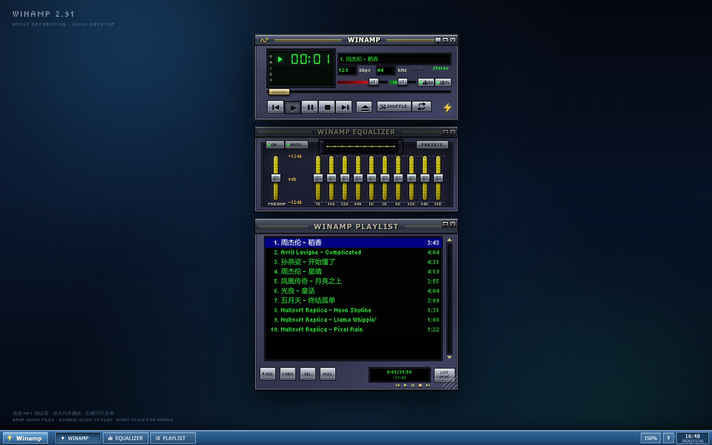
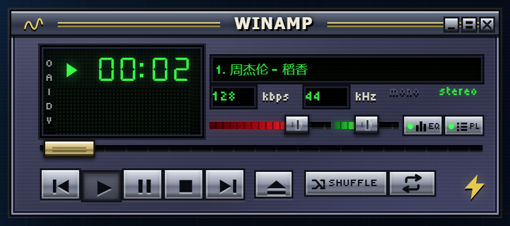
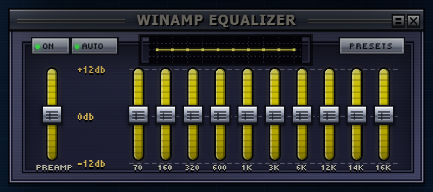
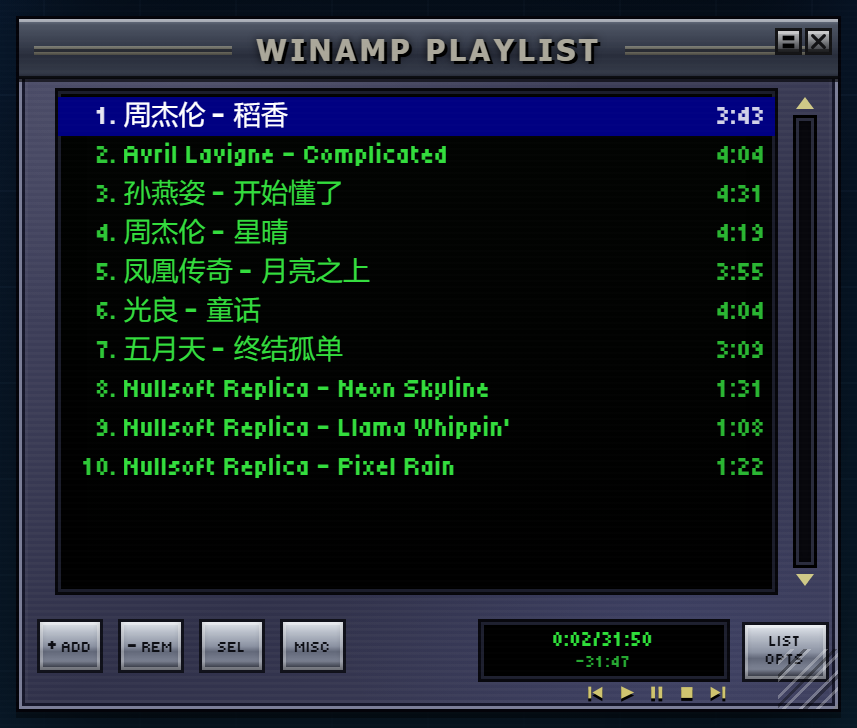
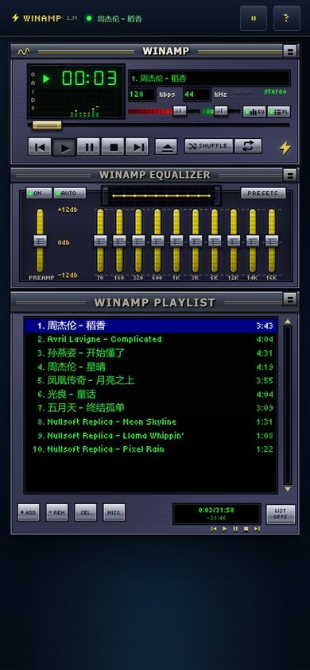

<div align="center">

<h1>WINAMP 2.91</h1>

<p><strong>HTML5 · 2000 年代桌面播放器复刻</strong></p>

<p>用 React 19 + Vite 8 + TypeScript + Web Audio API 重制的 Winamp 经典皮肤。<br />
所有像素均由 CSS / SVG / Canvas 现场绘制，不包含任何 Nullsoft 原始皮肤位图。</p>



</div>

> “It really whips the llama's ass!”

---

## 简介

这不是一个“现代音乐播放器套上复古配色”，而是按 Winamp 2.91 经典皮肤的原始坐标
（主窗口 275×116、均衡器 275×116、播放列表默认 275×232 并可拉伸）重新排布的可交互复刻：

- 桌面端**三扇窗口**默认纵向同宽排列，全部可拖动、互相吸附、双击标题栏进入卷帘（Window Shade）模式；
- 竖屏移动端把主窗口、均衡器、播放列表按同一比例、同宽向下吸附，可滚动查看；
- 播放列表可从右下角拉伸，窗口位置/尺寸会记住（桌面端）；
- **点阵 LCD** 上显示 9×13 的 DSEG 时间、滚动曲名、码率/采样率/单双声道；
- **实时频谱分析仪 / 示波器**由 Web Audio `AnalyserNode` 驱动，绘制成 Winamp 式点阵条；
- **10 段图形均衡器 + 前级**真正串在音频链路上，18 组经典预设一键切换；
- 桌面端底部任务栏可以重新打开被关掉的窗口，并切换 100% / 150% / 200% 界面比例；
  移动端使用顶部 now-playing 条，下方是纵向吸附的窗口栈。

内置三首原创合成 Demo，默认播放列表就是这三首 Demo；页面加载后会自动尝试播放
第一首，被浏览器拦截时首次点击/按键会继续播放。自己的 MP3 可直接拖放加入列表，
不会随仓库分发。

<table>
<tr>
<td></td>
<td></td>
</tr>
<tr>
<td align="center">主窗口 · 频谱 · 时间 · 音量/平衡</td>
<td align="center">10 段均衡器 · 曲线 · 预设</td>
</tr>
</table>



---

## 功能

### 播放

- 页面加载后自动尝试播放默认第一首；若浏览器拦截自动播放，首次点击/按键会自动继续播放
- HTML5 `<audio>` + Web Audio API 播放链：前级 → 10× peaking biquad → 平衡 → 主音量 → 分析器
- 播放 / 暂停 / 停止 / 上一首 / 下一首 / 进度拖动 / 音量 / 平衡
- Shuffle（随机）与 Repeat（关 / 全部 / 单曲循环）
- 时间显示点击切换「已播放 / 剩余」，暂停时数字闪烁
- 播放时点亮的 `kbps` / `kHz`、`mono` / `stereo` 指示
- Media Session：系统媒体键、锁屏/通知栏曲目信息

### 均衡器

- 70 / 160 / 320 / 600 / 1k / 3k / 6k / 12k / 14k / 16k 十段 + PREAMP，
  刻度为 +12 / 0 / -12 dB；金色滑杆与 E 字推子
- 每个滑块垂直拖动，也支持键盘（方向键 / Home / End）
- 顶部的 `ON` / `AUTO` / `PRESETS` 按钮
- EQ 曲线直接拖动即可塑形（拖动点最近的频段）
- 18 组内置预设：Flat、Classical、Club、Dance、Full Bass、Full Treble、Rock、Pop、Techno 等
  Winamp 经典组合
- `AUTO` 会按最大增益自动衰减前级，避免削波

### 可视化

- 点阵频谱：19 根 2px 柱，绿→黄→红分段，带峰值保持
- 示波器：时域波形
- 关闭：只留下 LCD 点阵底纹
- 点击可视化区域或 `V` 键循环切换
- 主窗口关闭后，播放列表底部的第二块可视化会接管显示

### 播放列表

- 拖放音频文件到任意位置即可加入并播放
- 双击播放；单击选择；`Ctrl` / `Shift` 多选
- 右键菜单：播放、删除、排序、全选
- `+ ADD` / `- REM` / `SEL` / `MISC` 四组经典按钮
- 排序（标题 / 文件名 / 时长）、随机、反转、裁剪到选中
- 自定义滚动条、迷你播放控制、双行时间显示（已播/总长 + 剩余）
- 右下 `LIST OPTS` 打开播放列表选项

### 经典细节

- 闪电 Logo、金色双线标题栏、金属斜面按钮、暗色点阵 LCD
- 主窗口 Clutterbar（`O A I D V`）
- 窗口不抢焦点时的“非活动”标题栏
- 右键菜单、W2K 风格的弹出菜单
- 拖放文件时的全屏虚线提示
- 双击闪电 Logo 进入“llama 模式”；About 里点 `WHIP THE LLAMA` 有合成音效
- 桌面壁纸、Win2K 风格任务栏、窗口任务按钮与时钟

### 持久化

以下设置写入 `localStorage`（key：`winamp-291:settings:v1`）：

- 音量、平衡、EQ（开关/自动/前级/10 段/预设名）
- 窗口位置、播放列表尺寸、界面比例、可视化模式、时间模式
- Shuffle / Repeat

播放列表本身**不会**持久化。浏览器不允许网页在刷新后继续读取用户本地文件；
Demo 曲目每次启动都会重新载入。

---

## 快速开始

环境：Node.js **22.12+**（Vite 8 要求），推荐 Node 24。

```bash
cd winamp
npm install
npm run dev
```

打开 <http://localhost:5273>。页面会自动尝试播放默认第一首 Demo；浏览器自动播放策略
拦截时，首次点击或按键会自动继续播放。

```bash
npm run build     # 类型检查 + 生产构建（dist/）
npm run preview   # 预览生产构建
```

> 请通过 HTTP 访问，不要直接双击 `dist/index.html`：ES Module 与音频资源都需要本地服务器。

桌面端首次打开会依据视口自动选择 100% / 150% / 200% 的界面比例（更窄的视口会继续缩小）；
右下角任务栏的百分比按钮可手动切换。竖屏移动端使用纵向窗口栈，自动适配。

### 移动端

<p align="center"></p>

竖屏且宽度 ≤ 760px 时自动进入移动布局：

- 顶部 now-playing 条：WINAMP 标识（点按打开菜单）、当前曲目、播放/暂停、About
- 下方依次是**主窗口 → 均衡器 → 播放列表**，三扇窗口同宽、同一比例向下吸附
- 三扇窗口边缘完全对齐；屏幕较小时整列可上下滚动
- 主窗口里的 `EQ` / `PL` 按钮用于展开/收起对应的下方面板
- 播放列表与桌面同为 275×232 设计尺寸、13px 行高，3 首默认 Demo 一屏可见
- 菜单放大为 30px 行高的触控尺寸，About 对话框自适应屏幕高度与列数
- 横屏 / 较宽屏幕仍使用桌面纵向窗口栈布局

> 移动端没有底部标签栏，也不提供窗口拖动/拉伸/关闭按钮；用 `EQ` / `PL` 按钮或顶部 WINAMP 菜单显示/隐藏面板。

---

## 快捷键

| 按键 | 功能 |
| --- | --- |
| `X` | 播放 |
| `C` | 暂停 |
| `V` | 停止 |
| `B` | 下一首 |
| `Z` | 上一首（播放超过 3 秒时先回到开头） |
| `L` / `Ctrl+O` | 打开文件 |
| `←` / `→` | 后退 / 前进 5 秒 |
| `↑` / `↓` | 音量 ±5 |
| `Shift+←` / `Shift+→` | 平衡 ±5 |
| `S` | Shuffle |
| `R` | 循环模式 |
| `T` / `Ctrl+T` | 已播放 / 剩余时间 |
| `D` / `Ctrl+D` | 界面双倍大小 |
| `Delete` | 删除选中的播放列表项 |
| `空格` | 播放 / 暂停 |
| `F1` | About / 快捷键 |
| `Esc` | 关闭菜单或 About |

**鼠标**

- 按住标题栏拖动窗口；靠近其他窗口边缘会自动吸附
- 双击标题栏 = 卷帘开/关
- 点击时间 = 切换剩余时间；点击可视化 = 切换频谱/示波器
- 主窗口内滚动滚轮 = 调音量
- 拖动播放列表右下角 = 调整大小
- 任意窗口/列表项上右键 = 对应菜单

**触屏（移动端）**

- 顶部 now-playing 条：播放 / 暂停、About；点按 WINAMP 标识打开菜单
- 上下滚动查看吸附在一起的主窗口、均衡器和播放列表
- 播放列表上下滑动；EQ 推子、音量/平衡/进度滑杆直接拖动
- 主窗口里的 `EQ` / `PL` 按钮展开/收起对应的下方面板

---

## 内置 Demo 音频

`public/demo/` 下的四段音频全部由 [`scripts/generate_demos.py`](scripts/generate_demos.py)
用 numpy 从头合成（原创旋律 / 音色 / 鼓机），128 kbps、44.1 kHz 立体声，
并写入 ID3v2.3 标签：

> 本仓库不再包含 `public/music/` 下的商业歌曲：它们属于原权利人，不能随开源项目
> 再分发。需要试听自己的音乐时，把本地 MP3 拖进播放列表即可，文件不会上传。

| 文件 | 曲目 | 风格 |
| --- | --- | --- |
| `neon-skyline.mp3` | Neon Skyline | Synthwave · 84 BPM |
| `llama-whippin.mp3` | Llama Whippin' | Chiptune / funk · 112 BPM |
| `pixel-rain.mp3` | Pixel Rain | Ambient · 70 BPM |
| `llama-whip.mp3` | Llama Whip | 彩蛋音效 |

重新生成（需要 `numpy`、`lameenc`、`mutagen`）：

```bash
python -m pip install numpy lameenc mutagen
python scripts/generate_demos.py
```

---

## 技术栈与架构

| 层 | 选择 |
| --- | --- |
| UI | React 19.3 + TypeScript 7 |
| 构建 | Vite 8.3（`@vitejs/plugin-react`） |
| 状态 | Zustand 5 |
| 音频 | Web Audio API（`BiquadFilterNode` / `StereoPannerNode` / `AnalyserNode`） |
| 图形 | Canvas 2D（可视化）、内联 SVG（图标/Logo/曲线）、CSS 渐变与阴影（皮肤） |
| 字体 | Tiny5、DSEG7 Classic（Fontsource，OFL） |
| 其他 | Media Session API、Pointer Events、CSS transform 缩放 |

音频链路：

```text
<audio>
  └─ Preamp Gain
      └─ 70Hz → 160Hz → 320Hz → 600Hz → 1k → 3k → 6k → 12k → 14k → 16k
          └─ StereoPanner (balance)
              └─ Master Gain (volume)
                  └─ AnalyserNode
                      └─ destination
```

桌面端所有窗口都在一个 330×520 的设计坐标系中；默认按
**主窗口 → 均衡器 → 播放列表** 纵向同宽排列（275px）。外层 `.stage` 通过
`transform: scale(0.4 – 2)` 整体缩放，保证像素边缘和字体缩放一致。
拖拽、吸附、调整大小都换算回设计坐标。
移动端则使用 `MobileDesktop` 将三扇窗口按同一比例缩放后纵向吸附。

```
winamp/
├─ public/
│  ├─ demo/                  # 4 个原创合成音频文件
│  └─ favicon.svg
├─ scripts/
│  └─ generate_demos.py      # Demo 合成 + MP3 编码 + ID3
├─ src/
│  ├─ audio/                 # AudioEngine / <audio> 绑定 / ID3 & MP3/WAV 解析
│  ├─ components/            # 三窗口、MobileDesktop、TitleBar、LCD、菜单、任务栏…
│  ├─ hooks/                 # 拖拽、缩放、滑杆、快捷键、移动端检测、持久化
│  ├─ lib/                   # 常量、预设、格式化、viewport、localStorage
│  ├─ menus/                 # 主菜单 / EQ 预设
│  ├─ store/                 # Zustand 播放器状态机
│  ├─ styles/                # 经典皮肤 CSS + mobile.css（纵向窗口栈）
│  └─ ui/                    # UiContext
├─ docs/                     # 截图
├─ index.html
└─ README.md
```

### 文件格式支持

- 播放：取决于浏览器解码器，常见 MP3 / WAV / OGG / FLAC / M4A / AAC / WebM 均可
- 元数据：内置 MP3 ID3v2.2/2.3/2.4 + ID3v1、MP3 帧头（码率/采样率/声道）、
  WAV `fmt ` 解析；其他格式回退到文件名 + 媒体时长
- 封面/歌词/文件内嵌图片不读取

---

## 说明与限制

- 这是一个**个人怀旧复刻练习**，与 Nullsoft / Winamp 没有关联；不包含官方皮肤、
  图标或音频素材。`WINAMP` 名称与经典视觉仅作为致敬。
- 只复刻了经典 Base 2.91 皮肤，**不支持加载 `.wsz` 皮肤包**，也没有
  Minibrowser / AVS / MilkDrop / 专辑封面等附带窗口。
- 播放列表不跨刷新持久化（浏览器不能静默读取本地文件）；音量、均衡器、
  窗口布局等设置会持久化。
- “Always on top” 在网页里只作为状态/菜单勾选存在（浏览器无法真正置顶系统窗口）；
  “Double size” 会将整个舞台放大，而不是只放大主窗口。
- 竖屏 ≤760px 会自动切换为移动纵向窗口栈；横屏仍使用桌面三窗口布局。移动端不提供窗口拖动/拉伸/关闭按钮；用 `EQ` / `PL` 按钮或顶部菜单显示/隐藏面板。
- 自动播放受浏览器策略约束：允许时加载即播放；被拦截时首次交互自动开始。
- 请使用较新的 Chrome / Edge / Firefox / Safari。

---

## 致谢

- **Winamp 2.91** by Nullsoft —— 原始经典皮肤与交互的灵感来源。
- [**Webamp**](https://github.com/captbaritone/webamp)（MIT）—— 仅作为经典皮肤
  控件坐标 / 布局的参考，本项目没有引入其运行时代码。
- [Tiny5](https://fonts.google.com/specimen/Tiny5)、
  [DSEG7 Classic](https://github.com/keshikan/DSEG) —— OFL 字体。
- React、Vite、Zustand、Fontsource 及所有开源依赖的作者。
- Demo 音乐由本项目的合成脚本生成，旋律与音色均为原创。
